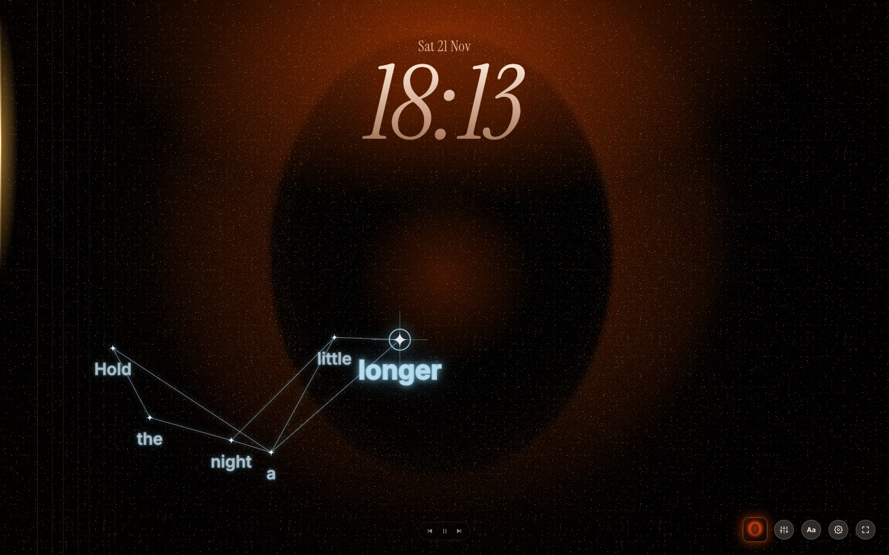
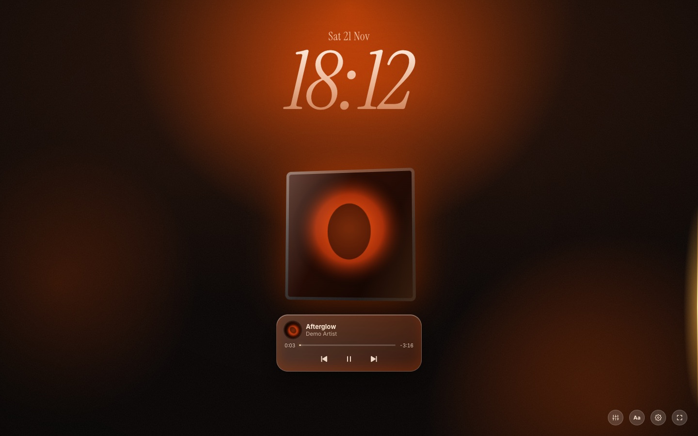
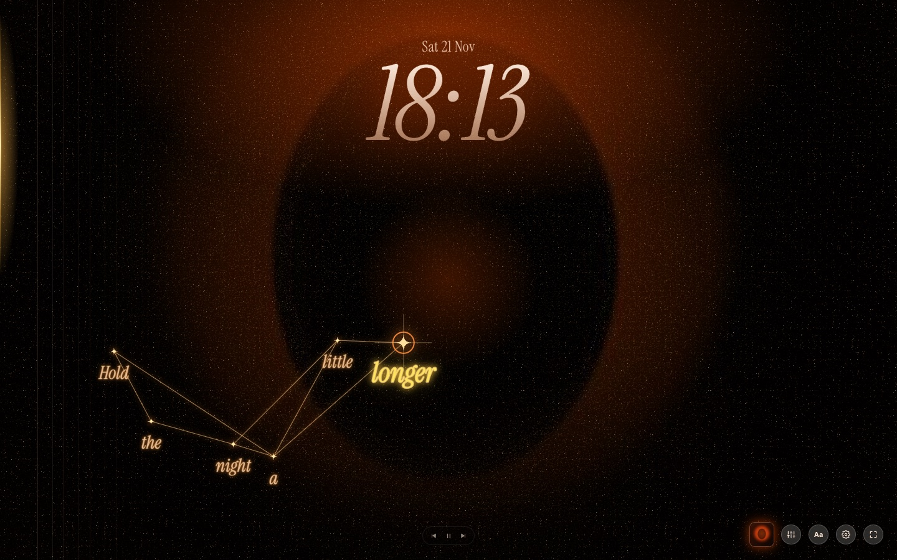
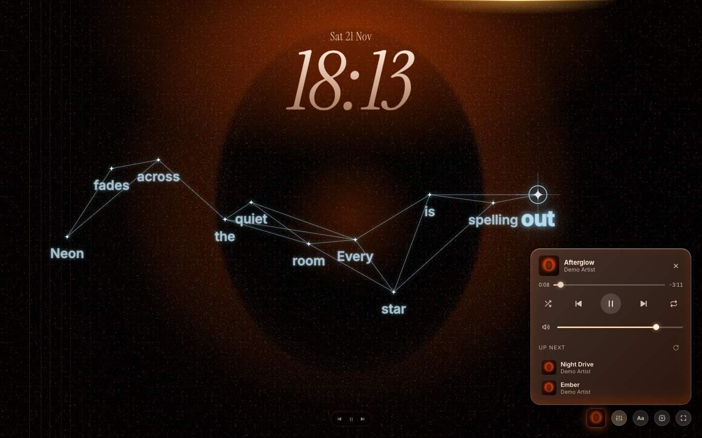
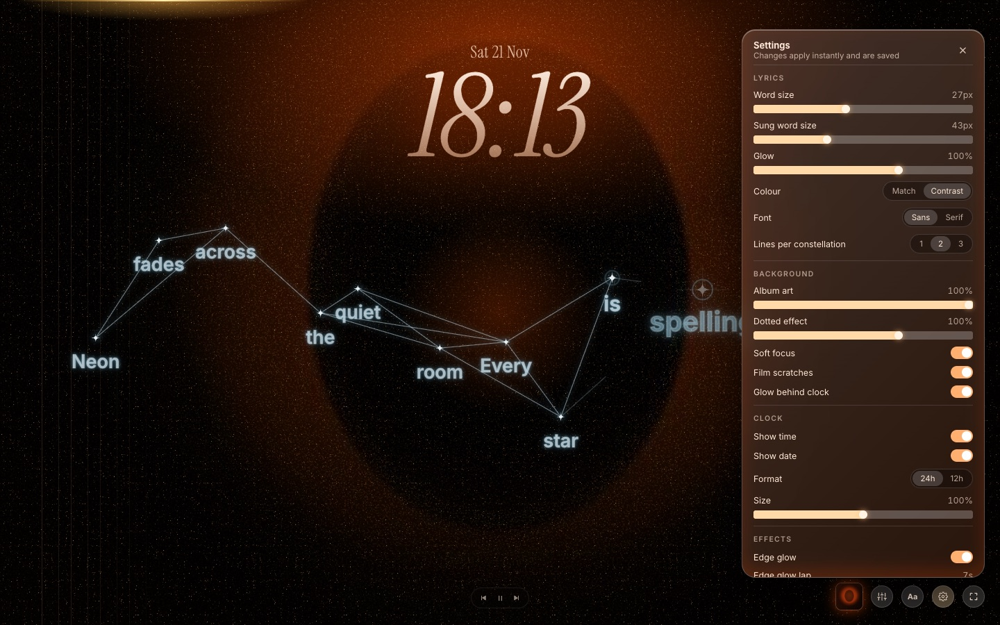

# Aesthetic Player

A fullscreen, lock-screen style music player for the desktop browser. It turns whatever you're playing into a moody, glowing wallpaper: colours pulled from the album art, a serif clock, a tilted album card, a glass mini player, and synced lyrics drawn as a constellation of stars.

Plays **Spotify** (Premium, in the browser via the Web Playback SDK) or **local audio files**.



| Player view | Lyrics: match colour + serif |
|---|---|
|  |  |
| **Controls panel** | **Settings panel** |
|  |  |

> Screenshots use the built-in demo mode (generated cover art, placeholder lyrics).

## Features

- **Album-art glow**: the background colours come from the current cover and crossfade between tracks.
- **Lyrics as a constellation**: each sung word becomes a glowing star joined to its neighbours; the word being sung grows, rings and glows. Synced lyrics come from [LRCLIB](https://lrclib.net).
- **Monochrome cover backdrop** in lyrics view: the cover fills the screen, tinted with its own colour, with soft focus, drifting orange specks and film scratches.
- **Match / Contrast lyric colour**: warm gold, or a silvery shade of the cover's opposite hue so lyrics stand out.
- **Travelling edge glow**: a gold light that circles the screen border.
- **Controls panel**: seek, shuffle, repeat, volume, the up-next queue, and (Spotify) paste a link to play or queue it.
- **Tiny on-screen transport** (prev / play / next) that can be switched off.
- **Fully customizable** from the settings panel (see below); settings are saved in the browser.
- **Per-track lyric offset**: nudge lyrics earlier or later if a track is out of sync; the fix is remembered.

## Quick start

Requires Node 20+.

```bash
npm install
npm run dev
```

Open **http://127.0.0.1:5173** (use `127.0.0.1`, not `localhost`; Spotify only accepts loopback IP redirects).

Want to see it without any setup? Open **http://127.0.0.1:5173/?demo** (add `&view=lyrics` to start in the lyrics view).

## Spotify setup

Spotify playback in the browser needs a **Spotify Premium** account and your own Spotify app (free):

1. Go to the [Spotify Developer Dashboard](https://developer.spotify.com/dashboard) and **Create app**.
2. Add the redirect URI `http://127.0.0.1:5173/callback` and tick **Web Playback SDK**.
3. Copy the app's **Client ID**, then:
   ```bash
   cp .env.example .env.local
   # set VITE_SPOTIFY_CLIENT_ID=<your client id>
   ```
4. Restart `npm run dev`, click **Log in with Spotify**, then **Connect Spotify**.
5. Pick the **Aesthetic Player** device in any Spotify app, or paste a track / album / playlist link.

No client secret is needed: login uses the Authorization Code flow with PKCE, entirely in the browser.

Use **Chrome or Safari** for Spotify: the SDK needs Widevine DRM, which some privacy browsers block.

## Local files

Click **Choose local files** or drop audio files (mp3, m4a, flac, wav, ogg, aac) anywhere on the page. Title, artist and cover art are read from the file's tags.

## Keyboard shortcuts

| Key | Action |
|---|---|
| `Space` | Play / pause |
| `L` | Switch player / lyrics view |
| `F` | Fullscreen |
| `C` | Controls panel |
| `S` | Settings panel |
| `[` / `]` | Lyrics 0.25 s later / sooner (saved per track) |
| `Esc` | Close panel |

## Settings

| Section | Options |
|---|---|
| Lyrics | word size, sung-word size, glow strength, colour (Match / Contrast), font (Sans / Serif), lines per constellation |
| Background | album art strength, dotted effect strength, soft focus, film scratches, glow behind clock |
| Clock | show time, show date, 24h / 12h, size |
| Effects | edge glow on/off, lap time, length, cursor glow, mini controls |

## How it works

- **Vite + React + TypeScript**, no backend.
- Playback sources share one interface (`src/sources/types.ts`): `LocalSource` (an `<audio>` element), `SpotifySource` (Web Playback SDK + Web API) and `DemoSource`.
- Position is interpolated between backend events and re-synced against the Spotify SDK every second, so lyrics stay smooth and in sync.
- LRCLIB only has line timing, so word timing is estimated by spreading each line across its words by length.
- The constellation is drawn on a `<canvas>`; layouts are seeded per lyric group, so seeking always reproduces the same shape.

### Performance notes

The lyrics view was tuned on a 2× Retina MacBook panel, where stacking many full-screen effects made Brave drop GPU tiles (flicker). The rules that fixed it:

- no `mix-blend-mode` or live CSS `filter` on full-screen layers; the cover's tint, tone curve and blur are baked into images once per track (`src/hooks/useDuotone.ts`);
- animate only `transform` / `opacity`, on layers no bigger than needed (the edge glow is four thin strips, not a rotating full-screen gradient);
- fully stop rendering layers that are hidden.

## Privacy

- Lyrics lookups send the track title, artist, album and duration to LRCLIB.
- Spotify tokens and your settings are stored in the browser's `localStorage`. Nothing is sent anywhere else.

## Project structure

```
src/
  App.tsx                 app shell, views, keyboard, dock
  settings.ts             customizable settings + persistence
  auth/spotify.ts         PKCE login, token refresh
  sources/                local, Spotify, demo playback backends
  lyrics/                 LRCLIB fetch + LRC parsing, lyric colours
  hooks/                  player state, palette, cover duotone
  components/             clock, constellation, cover backdrop, edge glow, panels…
```
